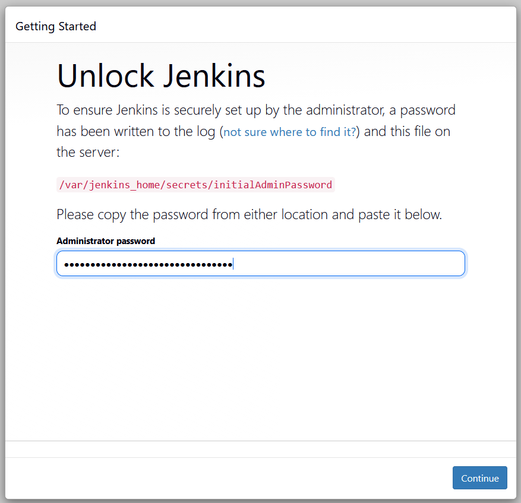
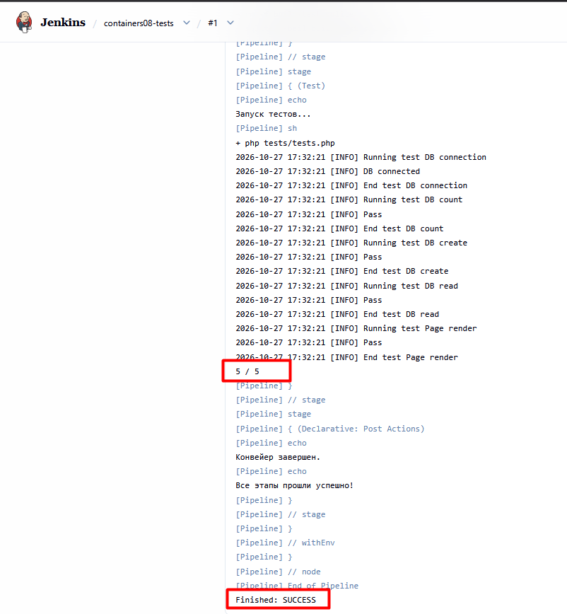

# IW04. Настройка Jenkins для автоматизации задач DevOps

## Цель работы

Настроить Jenkins Controller и SSH-агент в Docker и создать конвейер для запуска тестов PHP-проекта.

## Ход работы

### 1. Запуск Jenkins Controller

Создан файл `docker-compose.yml` с сервисом `jenkins-controller` на основе образа `jenkins/jenkins:lts`. Для хранения настроек подключён том `jenkins_home`, для доступа к интерфейсу открыт порт `8080`.

Контроллер запущен командой `docker compose up -d jenkins-controller`. В интерфейсе `http://localhost:8080` введён начальный пароль, установлены плагины и создан пользователь администратора.

### 2. Настройка SSH-агента

В папке `secrets` создана пара SSH-ключей. Публичный ключ добавлен в `.env` через переменную `JENKINS_AGENT_SSH_PUBKEY`, приватный — в Jenkins Credentials с ID `jenkins-agent-key` и пользователем `jenkins`.

Подготовлен `Dockerfile` на основе `jenkins/ssh-agent` с PHP CLI, SQLite и Git. В Compose добавлен сервис `ssh-agent`. Оба контейнера подключены к общей сети `jenkins-network`.

В Jenkins создан узел `ssh-agent1` с меткой `php-agent`, рабочей папкой `/home/jenkins/agent` и подключением по SSH к `ssh-agent:22`. Добавлен публичный ключ SSH-сервера для проверки подключения. После настройки узел перешёл в состояние online.

### 3. Создание конвейера

Для проверки выбран PHP-проект [containers08](https://github.com/Eredin1272/containers08), содержащий пять тестов работы с SQLite и формирования страницы.

В тестах исправлены пути к файлам, задана отдельная база `build/test.sqlite` и добавлен код завершения, позволяющий Jenkins обнаруживать провал тестов.

В репозиторий добавлен [Jenkinsfile](https://github.com/Eredin1272/containers08/blob/main/Jenkinsfile) с двумя этапами:

- **Install Dependencies** — проверка PHP и создание тестовой базы из `sql/schema.sql`.
- **Test** — запуск `php tests/tests.php`.

В Jenkins создана задача Pipeline, настроенная на загрузку `Jenkinsfile` из ветки `main` репозитория. Конвейер запущен кнопкой **Build Now** на агенте с меткой `php-agent`.

### 4. Результат

Все пять тестов прошли: в консоли получено `5 / 5`, сборка завершилась со статусом `Finished: SUCCESS`.

## Контрольные вопросы

**Преимущества Jenkins:** автоматизация повторяющихся задач, хранение конвейера в Git, история сборок и выполнение задач на отдельных агентах.

**Другие агенты:** агенты с входящим подключением, в том числе через WebSocket; постоянные и динамические агенты, например в Docker или Kubernetes.

**Возникшие проблемы:** исправлены отступы сервиса в Compose, отключено преобразование Linux-путей в Git Bash через `MSYS_NO_PATHCONV=1`, повторно установлены плагины. Для SSH-подключения имя пользователя исправлено на `jenkins` и повторно добавлен полный приватный ключ.

## Вывод

Настроены контроллер Jenkins и SSH-агент. Создан и успешно выполнен конвейер подготовки тестовой базы и запуска пяти тестов PHP-проекта.
