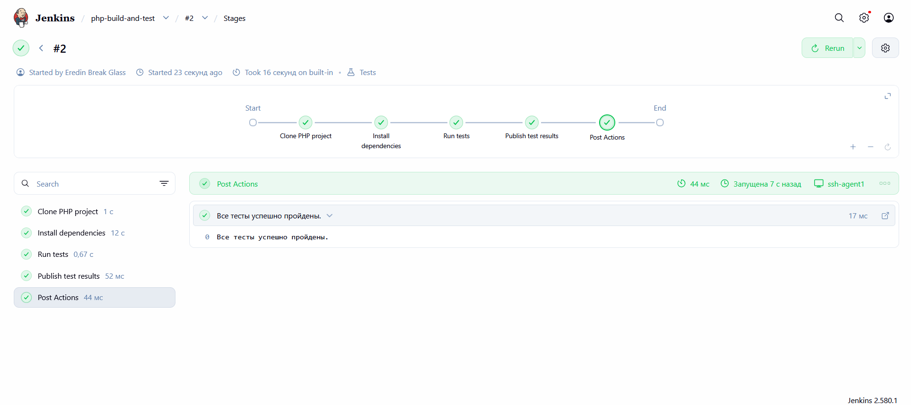
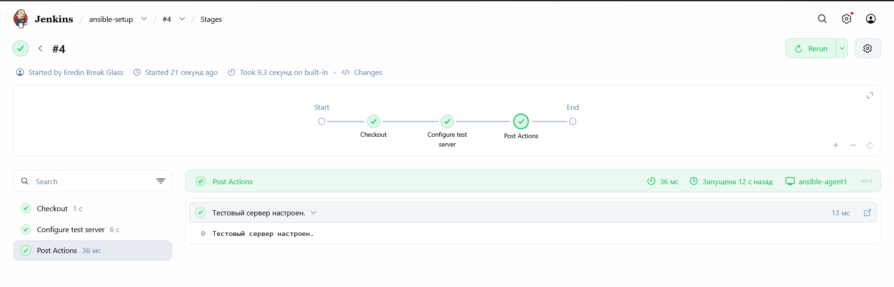
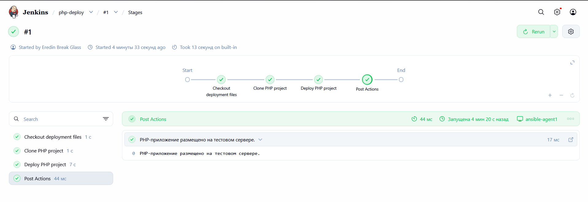

# IW05. Автоматизация настройки сервера с помощью Ansible и Jenkins

## Цель работы

Создать Ansible playbook для настройки тестового сервера и организовать сборку, тестирование и размещение PHP-приложения через Jenkins.

## Описание проекта

Для работы использован PHP-проект [containers08](https://github.com/Eredin1272/containers08). Приложение хранит страницы в SQLite и формирует HTML по шаблону. В проект добавлены Composer и пять тестов PHPUnit для проверки работы базы данных и формирования страницы.

## Подготовка окружения

На основе IW04 подготовлен [compose.yml](compose.yml) с четырьмя сервисами в общей сети `jenkins-network`.

| Сервис | Назначение |
|---|---|
| `jenkins-controller` | Управление конвейерами, веб-интерфейс на порту `8080` |
| `ssh-agent` | Установка зависимостей и запуск PHP-тестов |
| `ansible-agent` | Выполнение playbook и размещение приложения |
| `test-server` | Ubuntu-сервер с SSH, на котором развёрнуто приложение |

### Jenkins Controller

Контроллер запущен из образа `jenkins/jenkins:lts`. Данные сохранены в томе `jenkins_home`. Через `http://localhost:8080` выполнена начальная настройка, создан администратор и установлены плагины для Git, Pipeline, Docker, SSH и публикации результатов тестирования.

### SSH-агент для PHP

В [Dockerfile.ssh_agent](Dockerfile.ssh_agent) установлены PHP CLI, расширения SQLite, XML и mbstring, Composer, Git и SQLite. Сгенерирована пара SSH-ключей, публичный ключ передан агенту через `.env`, приватный добавлен в Jenkins Credentials. В Jenkins создан узел `ssh-agent1` с пользователем `jenkins` и меткой `php-agent`.

### Ansible-агент

Образ [Dockerfile.ansible_agent](Dockerfile.ansible_agent) подготовлен на базе Ubuntu 24.04. Установлены Ansible, SSH, Git и Java 21. Для подключения Jenkins создана отдельная пара ключей. Агент зарегистрирован как узел `ansible-agent1` с меткой `ansible-agent`.

### Тестовый сервер

В [Dockerfile.test_server](Dockerfile.test_server) установлены SSH-сервер, Python и sudo. Создан пользователь `ansible` с возможностью выполнять административные задачи через sudo. Для подключения Ansible используется отдельный SSH-ключ, приватная часть которого добавлена в Jenkins Credentials с ID `ansible-test-server`.

В [ansible/hosts.ini](ansible/hosts.ini) определена группа `test_servers` с сервером `test-server` и пользователем `ansible`. После добавления ключа сервера в `known_hosts` проверено подключение модулем `ansible.builtin.ping`. Получен ответ `pong`.

## Ansible playbook

[setup_test_server.yml](ansible/setup_test_server.yml) устанавливает Apache, PHP и SQLite, создаёт каталог `/var/www/php-project`, настраивает виртуальный хост, отключает стандартный сайт и запускает Apache. Задачи выполняются с `become: true`. При изменении конфигурации обработчик перезапускает Apache.

[deploy_php.yml](ansible/deploy_php.yml) копирует приложение на сервер, создаёт базу `/var/www/db/db.sqlite` из SQL-схемы и назначает права пользователю `www-data`. Инициализация пропускается, если база уже существует. В конце проверяется HTTP-ответ приложения с кодом `200`.

## Конвейеры Jenkins

Файлы конвейеров размещены в [pipelines](pipelines). Задачи Jenkins настроены через **Pipeline script from SCM** на репозиторий `automation`, ветку `lab05` и соответствующий Groovy-файл.

### Сборка и тестирование PHP

[php_build_and_test_pipeline.groovy](pipelines/php_build_and_test_pipeline.groovy) получает `containers08`, выполняет `composer install`, запускает PHPUnit и публикует XML-отчёт через шаг `junit`. Конвейер выполняется на `php-agent`. Все пять тестов завершились успешно.

### Настройка тестового сервера

[ansible_setup_pipeline.groovy](pipelines/ansible_setup_pipeline.groovy) получает репозиторий автоматизации, проверяет синтаксис и выполняет `setup_test_server.yml` на Ansible-агенте. Настройка сервера завершилась успешно.

### Размещение приложения

[php_deploy_pipeline.groovy](pipelines/php_deploy_pipeline.groovy) получает файлы автоматизации и PHP-проект, затем выполняет `deploy_php.yml` на Ansible-агенте. Размещение завершилось успешно. Приложение открыто в браузере по адресу `http://localhost:8081`, страница отобразилась корректно.

## Контрольные вопросы

### Какие преимущества даёт Ansible для настройки серверов?

Ansible позволяет описывать конфигурацию в YAML и повторять настройку на нескольких серверах через SSH. На управляемом сервере обычно достаточно SSH и Python. Идемпотентные модули позволяют повторно выполнять задачи, приводя сервер к нужному состоянию. Playbook можно хранить в Git и запускать из Jenkins.

### Какие ещё бывают модули управления конфигурацией?

Для управления пакетами используются `apt` и `dnf`, файлами — `file`, `copy` и `template`, службами — `service` и `systemd_service`. Модули `user`, `group`, `git` и `cron` позволяют управлять пользователями, группами, репозиториями и заданиями по расписанию.

### Какие проблемы возникли и как они были решены?

- После пересоздания контейнеров изменялись ключи SSH-серверов. Актуальные ключи добавлены в настройки узлов Jenkins и в `known_hosts` Ansible-агента.
- Шаг `sshagent` отсутствовал в Pipeline. Установлен плагин SSH Agent и перезапущен контроллер.
- Ansible не находил сервер из-за несовпадения имени группы. В инвентаре и командах указано одинаковое имя `test_servers`.

## Вывод

Настроены четыре контейнера и три конвейера Jenkins. Ansible автоматизирует конфигурацию сервера и размещение приложения. Все пять тестов PHPUnit прошли успешно, результаты опубликованы в Jenkins, работа приложения проверена в браузере.
